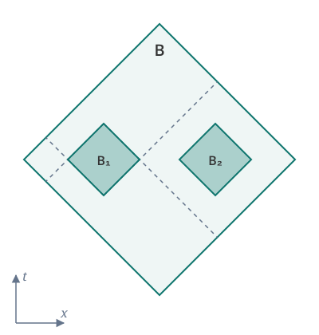

# physicslib4

A Lean 4 library for axiomatic physics.

Official website at <https://physicslib.github.io/physicslib4/>.

<p align="center">
  <picture>
    <source media="(prefers-color-scheme: dark)" srcset="web/static_files/axiom3-diagram-dark.svg">
    
  </picture>
</p>

<p align="center"><em>Axiom 3 in one picture: the diamonds B₁ and B₂ are spacelike separated inside B, so their observables commute.</em></p>

# What's physicslib4?

physicslib4 aims to formalise axiomatic physical theories in the [Lean 4 theorem prover](https://leanprover-community.github.io). The library covers algebraic quantum field theory: the [Haag–Kastler axioms](https://doi.org/10.1063/1.1704187) in Minkowski and curved spacetime, the GNS construction, spectral theory and Stone's theorem.

## Goal

This project works towards a formal resolution of **Hilbert's 6th problem**: a rigorous mathematical treatment of the axioms underlying physical theories.

Hilbert asked for a treatment analogous to what Euclidean geometry received from his own *Grundlagen der Geometrie*. Modern physics has produced candidate axiom systems — operator-algebraic frameworks for quantum mechanics and quantum field theory chief among them — but these have never been subjected to the kind of machine-checked formal scrutiny that Lean makes possible. This project aims to change that.

# Getting Started

Requires [Lean 4](https://leanprover-community.github.io/get_started.html) and [Mathlib4](https://github.com/leanprover-community/mathlib4), both at v4.35.0, as pinned by `lean-toolchain` and `lakefile.toml`.

```bash
git clone https://github.com/physicslib/physicslib4.git
cd physicslib4
lake exe cache get    # download prebuilt dependencies
lake build            # build the project
```

# Contributing

Contributions are welcome; see [Get Involved](https://physicslib.github.io/physicslib4/get-involved/). The [blueprint](https://physicslib.github.io/physicslib4/blueprint/) is the canonical guide to what is stated and what is proved. The tutorial's chapter ["Doing it yourself"](https://physicslib.github.io/physicslib4/tutorial/Doing-it-yourself/) explains how to set up Lean, add a result to the blueprint and the library, and run the checks; a pull request against `main` is merged once it passes all status checks, has no conflicts with `main`, and is approved by a reviewer.

# Acknowledgements

We are grateful to Rudolf Haag and Daniel Kastler for their foundational work, and to the authors of [Entanglement in Algebraic Quantum Field Theories](https://arxiv.org/abs/2410.16599) for their clear presentation of the GNS construction that the blueprint in part follows. We thank the Mathlib maintainers and the broader Lean community for their support, and Project Numina for partially supporting this research.

---

Maintained by [Kelly J Davis](https://github.com/kellyjdavis).
